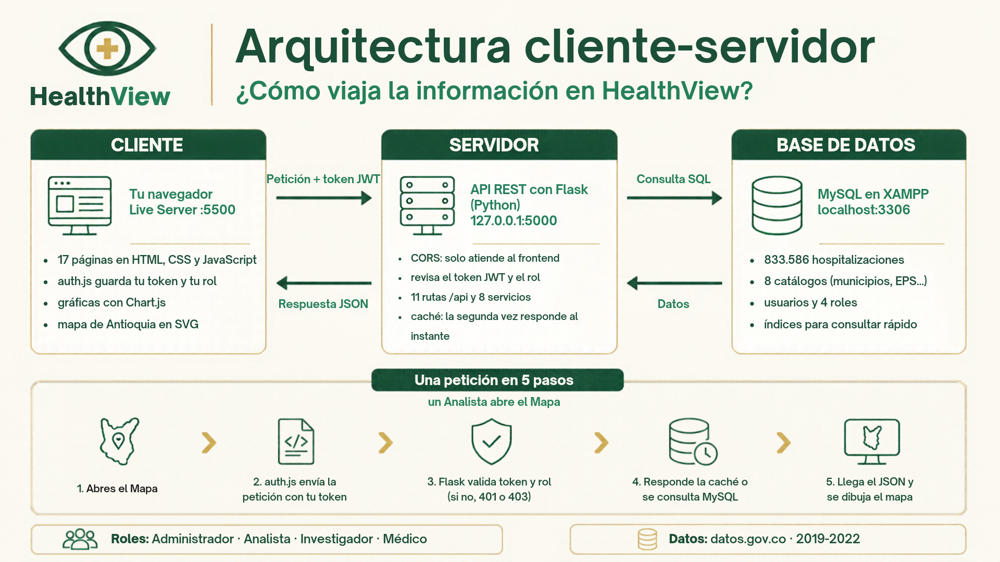

# HealthView — Plataforma inteligente para la gestión hospitalaria y analítica clínica

> Proyecto del **Grupo Chill** · Programación Web · Universidad Libre

HealthView convierte los registros de hospitalización en información útil para tomar decisiones: tendencias, enfermedades frecuentes, estancias, alertas y reportes automáticos.

## Contenido

1. [El problema](#el-problema)
2. [Datos del proyecto](#datos-del-proyecto)
3. [Módulos de la plataforma](#módulos-de-la-plataforma)
4. [Roles de usuario y flujo de autenticación](#roles-de-usuario-y-flujo-de-autenticación)
5. [Arquitectura y tecnologías](#arquitectura-y-tecnologías)
6. [Estructura del repositorio](#estructura-del-repositorio)
7. [Cómo ejecutar el proyecto](#cómo-ejecutar-el-proyecto)
8. [Guía de archivos](#guía-de-archivos)
9. [API: endpoints disponibles](#api-endpoints-disponibles)
10. [Modelo entidad-relación](#modelo-entidad-relación)
11. [Equipo](#equipo)

---

## El problema

Muchos hospitales guardan enormes cantidades de registros de hospitalización y no los aprovechan para:

- Detectar tendencias.
- Anticipar la ocupación hospitalaria.
- Identificar las enfermedades más frecuentes.
- Medir la duración de las estancias.
- Generar reportes automáticamente.

**HealthView centraliza esta información y la presenta de forma clara, visual y accesible.**

## Datos del proyecto

|                                |                                                                                                                                                                                           |
| ------------------------------ | ----------------------------------------------------------------------------------------------------------------------------------------------------------------------------------------- |
| **Fuente**                     | Registro de prestación de servicios médicos en hospitalización ([datos.gov.co](https://www.datos.gov.co/dataset/Registro-Prestaci-n-Servicios-M-dicos-en-Hospitali/6bjy-46fk/about_data)) |
| **Registros originales**       | 839.738 (24 columnas)                                                                                                                                                                     |
| **Registros tras la limpieza** | 833.586 (se eliminaron 6.152 duplicados)                                                                                                                                                  |
| **Cobertura**                  | Medellín / Antioquia, Colombia, 2019-2022                                                                                                                                                 |

> Los archivos CSV pesan más de 100 MB y **no están en el repositorio** (GitHub no los acepta). Descárgalos de la fuente y límpialos antes de importarlos.

## Módulos de la plataforma

| #   | Módulo                           | Qué ofrece                                                                                                             |
| --- | -------------------------------- | ---------------------------------------------------------------------------------------------------------------------- |
| 1   | **Panel inteligente**            | Hospitalizaciones, pacientes por edad y sexo, diagnósticos frecuentes, estancia promedio, tasas de egreso y mortalidad |
| 2   | **Análisis de tendencias**       | Comparación mensual y anual, enfermedades que más crecen, temporadas de mayor demanda                                  |
| 3   | **Mapa epidemiológico**          | Hospitalizaciones por municipio o departamento y comparación entre regiones                                            |
| 4   | **Sistema de alertas**           | Avisos por aumentos repentinos de una enfermedad, ocupación alta o estancias muy largas                                |
| 5   | **Búsqueda y filtros avanzados** | Por diagnóstico, edad, sexo, EPS, prestador, municipio y fechas                                                        |
| 6   | **Reportes automáticos**         | Exportación a PDF y Excel, indicadores a medida, resúmenes ejecutivos                                                  |
| 7   | **Comparador de indicadores**    | Compara hospitales, municipios, aseguradoras y periodos                                                                |

## Roles de usuario y flujo de autenticación

| Rol               | Uso principal                            |
| ----------------- | ---------------------------------------- |
| **Administrador** | Gestiona usuarios y configuración        |
| **Analista**      | Explora tendencias, filtros y reportes   |
| **Investigador**  | Consulta y compara datos epidemiológicos |
| **Médico**        | Revisa indicadores clínicos y alertas    |

### Acceso por rol

Los permisos se validan en la API; ocultar enlaces en la interfaz no sustituye
esa validación.

| Rol | Accesos |
| --- | --- |
| **Administrador** | Todos los módulos y operaciones de administración |
| **Analista** | Panel, mapa, búsqueda y reportes |
| **Investigador** | Panel y mapa |
| **Médico** | Panel y alertas |

La búsqueda devuelve como máximo 10 registros por solicitud. Los endpoints de
catálogos requieren una sesión activa; las operaciones sobre usuarios y los
registros de hospitalización son exclusivas del Administrador.

### Flujo de cuentas y seguridad (Sin registro público)

La plataforma **no cuenta con registro público** (`signin.html` / `/api/auth/registro` quedan descartados). Las cuentas solo las crea un **Administrador** autenticado:

1. **Primer Administrador**: Se crea una única vez desde consola mediante `python crear_admin.py`, el cual inserta el usuario directamente en la base de datos con un hash generado por `werkzeug.security` (`debe_cambiar_clave = 0`).
2. **Creación de cuentas**: El Administrador inicia sesión, entra a gestión de usuarios y registra cuentas nuevas (nombre, correo y rol) mediante `POST /api/usuarios`. Toda cuenta creada por el Administrador nace activa (`activo = 1`).
3. **Contraseña temporal**: El sistema genera automáticamente una contraseña temporal aleatoria y se la muestra al Administrador **una sola vez** para que la entregue al usuario. El Administrador no escoge la contraseña.
4. **Cambio obligatorio en primer ingreso**: Cuando el usuario inicia sesión con su clave temporal (`debe_cambiar_clave = 1`), el sistema lo obliga a cambiarla antes de permitirle navegar por la plataforma.
5. **Recuperación de contraseña**: Si un usuario olvida su contraseña, solicita al hospital/Administrador la generación de una nueva clave temporal, lo cual vuelve a activar `debe_cambiar_clave = 1`.

## Arquitectura y tecnologías
## Arquitectura Cliente Servidor


```
Datos originales (CSV) → Limpieza (Python/pandas) → Base de datos (MariaDB/MySQL) → API (Flask) → Frontend web
```

| Capa              | Tecnología                                                          |
| ----------------- | ------------------------------------------------------------------- |
| Limpieza de datos | Python 3 + pandas                                                   |
| Base de datos     | MariaDB 10.4+ / MySQL 8 (XAMPP)                                     |
| Backend           | Python 3 + Flask 3, Flask-SQLAlchemy, Flask-CORS, PyMySQL, Werkzeug |
| Frontend          | HTML5, CSS3, JavaScript vanilla (Fetch API), Bootstrap 5 y React 18 vía CDN para las métricas de la página de inicio |

Cómo se comunican las partes: el navegador carga las páginas HTML, el JavaScript pide datos a la API en `http://127.0.0.1:5000/api/...`, la API consulta la base de datos con SQLAlchemy y responde en JSON.


## Estructura del repositorio

```
HealthView/
├── README.md
├── .gitignore
├── Backend/                          # API en Flask
│   ├── run.py                        # Arranca el servidor
│   ├── crear_admin.py                # Crea el primer usuario Administrador en BD
│   ├── config.py                     # Configuración (lee el .env)
│   ├── requirements.txt              # Dependencias de Python
│   ├── .env.example                  # Plantilla de variables de entorno
│   └── app/
│       ├── __init__.py               # Fábrica de la app (create_app)
│       ├── extensions.py             # db y cors
│       ├── models/                   # Tablas como clases de Python (catalogos, hospitalizacion, usuario)
│       ├── routes/                   # Endpoints HTTP (health, catalogos, hospitalizaciones, auth)
│       ├── services/                 # Reglas de negocio y validaciones
│       └── utils/                    # Manejo de errores
├── Frontend/
│   ├── html/
│   │   ├── index.html                # Página de presentación
│   │   └── login.html                # Inicio de sesión
│   ├── css/
│   │   ├── base.css                  # Paleta y reinicio compartidos
│   │   ├── landing.css               # Estilos de index.html
│   │   └── login.css                 # Estilos de login.html
│   ├── javascript/
│   │   └── login.js                  # Lógica del login y conexión con /api/auth/login
│   └── img/                          # Logotipos
├── docs/                             # Diagrama entidad-relación y especificación OpenAPI
└── db/
    └── scripts/
        ├── crear_base_datos.sql      # Crea la base, tablas y restricciones
        ├── importar_datos.sql        # Carga los CSV
        ├── validaciones.sql          # Revisa la calidad de los datos
        └── consultas_prueba.sql      # Consultas por módulo y vistas
```

## Cómo ejecutar el proyecto

Esta guía está pensada para alguien que nunca ha ejecutado el proyecto. Sigue los pasos **en orden** y no te saltes ninguno. Las instrucciones son para **Windows**. 

Para que puedas copiar las rutas tal cual, toda la guía usa esta carpeta de ejemplo:

```
C:\proyecto\HealthView
```

Si usas otra carpeta, cambia `C:\proyecto\HealthView` por la tuya **en cada comando y en cada archivo** donde aparezca. La guía avisa cada vez que haya que cambiar una ruta.

> **Importante:** usa una ruta **corta, sin espacios, sin tildes y fuera de OneDrive**. El comando `SOURCE` de MySQL falla con rutas que tienen espacios, y OneDrive puede bloquear los archivos mientras los sincroniza.

### Paso 0. Instalar los programas necesarios

| Programa | Para qué | Descarga |
| --- | --- | --- |
| **XAMPP** (incluye MySQL/MariaDB) | Base de datos | <https://www.apachefriends.org/> |
| **Python 3.10 o superior** | Backend (API) | <https://www.python.org/downloads/> |
| **Visual Studio Code** | Editar archivos y abrir el frontend | <https://code.visualstudio.com/> |
| Extensión **Live Server** de VS Code | Servir el frontend | En VS Code: pestaña Extensiones (Ctrl+Shift+X) → buscar "Live Server" (de Ritwick Dey) → Instalar |
| **Git** (opcional) | Clonar el repositorio | <https://git-scm.com/> |

Al instalar Python, **marca la casilla "Add python.exe to PATH"** en la primera pantalla del instalador. Para comprobar que quedó bien, abre una terminal (tecla Windows → escribe `PowerShell` → Enter) y ejecuta:

```powershell
python --version
```

Debe mostrar `Python 3.10` o una versión mayor. Si dice que no se reconoce el comando, reinstala Python marcando esa casilla.

### Paso 1. Descargar el proyecto y los datos

**1.1. Descarga el código** en `C:\proyecto\HealthView`. Elige una de las dos opciones:

- Con Git:

  ```powershell
  mkdir C:\proyecto
  cd C:\proyecto
  git clone https://github.com/estephanyrm/HealthView.git
  ```

- Sin Git: en GitHub pulsa **Code → Download ZIP** y descomprime el ZIP de forma que la carpeta quede exactamente en `C:\proyecto\HealthView`. Dentro debe haber `Backend`, `Frontend`, `db`, `docs` y `README.md`. Si al descomprimir queda una carpeta extra, por ejemplo `HealthView-main\HealthView-main`, mueve el contenido un nivel arriba.

**1.2. Consigue los datos limpios.** Los CSV pesan unos 100 MB y **no están en GitHub**, porque GitHub no acepta archivos tan grandes. El script de limpieza tampoco está en el repositorio, así que **pide al equipo (Grupo Chill) la carpeta `datos_limpios`** y cópiala en:

```
C:\proyecto\HealthView\db\datos_limpios\
```

Esa carpeta debe contener **estos 7 archivos**. Si falta alguno, la importación falla.

| Archivo | Filas que debe tener (sin contar el encabezado) |
| --- | --- |
| `departamento.csv` | 33 |
| `municipio.csv` | 714 |
| `eps.csv` | 289 |
| `prestador.csv` | 71 |
| `diagnostico.csv` | 8.361 |
| `hospitalizacion.csv` | 833.586 (unos 88 MB) |
| `hospitalizacion_diagnostico.csv` | 608.624 (unos 16 MB) |

> Git ignora la carpeta `datos_limpios` (está en `.gitignore`), así que no se subirá al repositorio por error.

### Paso 2. Preparar MySQL (XAMPP)

**2.1. Habilita la carga de archivos locales (`LOCAL INFILE`).** Sin esto, la importación del paso 3 falla con el error *"Loading local data is disabled"*.

1. Abre el **XAMPP Control Panel**.
2. En la fila **MySQL**, pulsa **Config → my.ini**. El archivo es `C:\xampp\mysql\bin\my.ini`.
3. Busca la línea `[mysqld]` y escribe **justo debajo**:

   ```ini
   local_infile=1
   ```

4. Busca la línea `[mysql]`. Si no existe, créala al final del archivo. Escribe debajo:

   ```ini
   local-infile=1
   ```

5. Guarda el archivo.
6. En XAMPP pulsa **Stop** y luego **Start** en MySQL. El nombre debe quedar en verde.

**2.2. Abre el cliente de MySQL** en una terminal de PowerShell:

```powershell
C:\xampp\mysql\bin\mysql.exe -u root --local-infile=1
```

Debe aparecer el indicador `MariaDB [(none)]>`. XAMPP crea el usuario `root` **sin contraseña**. Si tú le pusiste una, agrega `-p` al final del comando y escríbela cuando la pida.

> Deja esta ventana abierta: los pasos 3.1 a 3.5 se escriben aquí. En `SOURCE` las rutas van con barras normales `/`, no con `\`.

### Paso 3. Crear la base de datos e importar los datos

**3.1. Crea la base de datos y sus tablas.** Este script **borra `hospitalizacion_db` si ya existe** y la crea de nuevo, vacía:

```sql
SOURCE C:/proyecto/HealthView/db/scripts/crear_base_datos.sql;
```

Al final debe mostrar la lista de tablas (`SHOW TABLES`). Este script ya agrega a `usuario` las columnas `fecha_creacion`, `ultimo_acceso` y `debe_cambiar_clave`. **No las agregues a mano**: obtendrías el error *"Duplicate column name"*.

**3.2. Cambia las rutas en el script de importación.** El archivo `db/scripts/importar_datos.sql` tiene las rutas de los CSV escritas a mano. Hay **7 líneas** como esta:

```sql
LOAD DATA LOCAL INFILE "C:/proyecto/datos_limpios/departamento.csv"
```

1. Abre `C:\proyecto\HealthView\db\scripts\importar_datos.sql` en VS Code.
2. Pulsa **Ctrl+H** (Buscar y reemplazar).
3. En **Buscar** escribe: `C:/proyecto/datos_limpios`
4. En **Reemplazar** escribe la ruta real de tu carpeta de datos, con barras `/` y **sin** barra final. Con la carpeta del paso 1.2 sería:

   ```
   C:/proyecto/HealthView/db/datos_limpios
   ```

5. Pulsa **Reemplazar todo** (Ctrl+Alt+Enter) y guarda con **Ctrl+S**.

Al terminar, la primera línea debe quedar así:

```sql
LOAD DATA LOCAL INFILE "C:/proyecto/HealthView/db/datos_limpios/departamento.csv"
```

> Si usas otra carpeta, por ejemplo `D:/datos/datos_limpios`, pon esa ruta. Lo importante es que las 7 líneas apunten a la carpeta donde están de verdad los 7 CSV.

**3.3. Importa los datos.** Tarda varios minutos (son más de 830 mil filas) y la ventana parece quieta mientras trabaja: no la cierres.

```sql
SOURCE C:/proyecto/HealthView/db/scripts/importar_datos.sql;
```

Al terminar muestra una tabla con el conteo de filas por tabla, que debe coincidir con la del paso 1.2: `hospitalizacion` 833586, `hospitalizacion_diagnostico` 608624, etc.

**3.4. Crea los índices de rendimiento.** Son muy recomendables: sin ellos, el Panel inteligente puede tardar más de 2 minutos en cargar la primera vez; con ellos, unos 7 segundos.

```sql
SOURCE C:/proyecto/HealthView/db/scripts/optimizacion_indices_dashboard.sql;
SOURCE C:/proyecto/HealthView/db/scripts/modulo_alertas_busqueda_reportes.sql;
```

Ejecútalos **en este orden**. Si ves *"Duplicate key name"* en algún índice, es que ya existía y puedes ignorarlo.

**3.5. (Opcional) Valida los datos.** Muestra los conteos y comprueba las reglas de integridad:

```sql
SOURCE C:/proyecto/HealthView/db/scripts/validaciones.sql;
```

> `consultas_prueba.sql` tiene consultas de ejemplo de cada módulo. No es necesario para ejecutar la plataforma y puede tardar varios minutos.

Escribe `exit` para salir del cliente de MySQL. **MySQL debe seguir encendido en XAMPP** mientras uses la plataforma.

### Paso 4. Configurar y arrancar el backend (API)

Abre una **terminal nueva** de PowerShell y entra en la carpeta del backend:

```powershell
cd C:\proyecto\HealthView\Backend
```

**4.1. Crea el entorno virtual de Python.** Se hace una sola vez:

```powershell
python -m venv .venv
```

**4.2. Activa el entorno virtual.** Hay que hacerlo **cada vez que abras una terminal nueva** para el backend:

```powershell
.\.venv\Scripts\Activate.ps1
```

El indicador de la terminal debe empezar con `(.venv)`. Si aparece el error *"la ejecución de scripts está deshabilitada en este sistema"*, ejecuta esto **una sola vez** y vuelve a activar el entorno:

```powershell
Set-ExecutionPolicy -Scope CurrentUser RemoteSigned
```

> Si usas **CMD** en lugar de PowerShell, el comando de activación es `.venv\Scripts\activate.bat`.

**4.3. Instala las dependencias.** Con `(.venv)` activo:

```powershell
pip install -r requirements.txt
```

**4.4. Crea el archivo de configuración `.env`** a partir de la plantilla:

```powershell
copy .env.example .env
```

Abre `C:\proyecto\HealthView\Backend\.env` en VS Code y revisa estos valores:

| Variable | Qué poner |
| --- | --- |
| `SECRET_KEY` | Una clave larga y aleatoria. Genera una con el comando de abajo y pégala. |
| `JWT_SECRET_KEY` | **Otra** clave distinta, generada igual. Es la que firma las sesiones (JWT). |
| `DB_HOST`, `DB_PORT` | `localhost` y `3306` (los de XAMPP). Cámbialos solo si tu MySQL usa otro puerto. |
| `DB_USER`, `DB_PASSWORD` | `root` y vacío, que son los de XAMPP. Si le pusiste contraseña a `root`, escríbela en `DB_PASSWORD`. |
| `DB_NAME` | `hospitalizacion_db`. No lo cambies. |
| `CORS_ORIGINS` | Las direcciones desde las que se abre el frontend. El valor de la plantilla (`http://127.0.0.1:5500,http://localhost:5500`) sirve para Live Server. Si Live Server usa otro puerto (ver paso 5.3), **agrégalo aquí** separado por coma. |

Para generar cada clave aleatoria, ejecuta este comando dos veces, una para cada clave:

```powershell
python -c "import secrets; print(secrets.token_urlsafe(48))"
```

Guarda el archivo con **Ctrl+S**.

**4.5. Crea el primer usuario Administrador.** Se hace una sola vez:

```powershell
python crear_admin.py
```

El script pide nombre, correo y contraseña (mínimo 8 caracteres). La contraseña no se ve mientras la escribes; es normal. **Anota el correo y la contraseña**, porque son los que usarás para iniciar sesión. Si responde *"Ya existe un Administrador"*, ya hay uno creado y puedes seguir.

**4.6. Arranca la API:**

```powershell
python run.py
```

Debe mostrar `Running on http://127.0.0.1:5000`. **Deja esta terminal abierta**: si la cierras, la API se apaga.

**4.7. Comprueba que funciona.** Abre en el navegador <http://127.0.0.1:5000/api/health>. Debe responder:

```json
{ "base_de_datos": "conectada", "estado": "ok" }
```

> Al arrancar, la API calcula en segundo plano el Panel, el Mapa y las Alertas y los guarda en caché. Durante los **primeros 1-2 minutos** esas páginas pueden tardar en cargar; después cargan al instante.
>
> La documentación interactiva de la API (Swagger) está en <http://127.0.0.1:5000/api/docs>.

### Paso 5. Abrir el frontend

**5.1.** En VS Code abre la **carpeta raíz del proyecto**: menú **File → Open Folder…** → `C:\proyecto\HealthView`.

**5.2.** En el explorador de la izquierda, abre `Frontend/html/index.html`. Haz **clic derecho** dentro del archivo → **Open with Live Server**. También puedes pulsar el botón **Go Live** de la barra inferior.

**5.3.** Se abrirá el navegador en una dirección como:

```
http://127.0.0.1:5500/Frontend/html/index.html
```

Fíjate en el **puerto** (el número después de `:`). Si **no es 5500**, por ejemplo `5501` porque el 5500 estaba ocupado, agrégalo a `CORS_ORIGINS` en `Backend\.env`, por ejemplo `...,http://127.0.0.1:5501`. Después reinicia la API: en su terminal pulsa **Ctrl+C** y vuelve a ejecutar `python run.py`.

> **No abras los HTML con doble clic** (`file:///...`). El navegador bloquea las peticiones a la API desde archivos locales y verás *"No se pudo conectar con el servidor"*. Usa siempre Live Server.

**5.4.** Pulsa **Iniciar sesión** y entra con el correo y la contraseña del Administrador del paso 4.5.

### Paso 6. Crear las demás cuentas (opcional)

No hay registro público: las cuentas las crea el Administrador.

1. En el menú, entra en **Usuarios → Crear usuario**.
2. Escribe nombre, correo y rol (Analista, Investigador o Médico).
3. El sistema muestra **una sola vez** una contraseña temporal. Cópiala y entrégala al usuario.
4. La primera vez que ese usuario inicie sesión, el sistema lo obliga a cambiarla.

Cada rol solo ve los módulos que tiene permitidos (ver [Acceso por rol](#acceso-por-rol)).

### Cómo volver a abrir el proyecto otro día

Ya no hace falta repetir la instalación. Solo:

1. Abre **XAMPP** y pulsa **Start** en **MySQL**.
2. En una terminal, arranca la API:

   ```powershell
   cd C:\proyecto\HealthView\Backend
   .\.venv\Scripts\Activate.ps1
   python run.py
   ```

3. En VS Code, abre `Frontend/html/index.html` con **Open with Live Server**.


## Modelo entidad-relación


## Equipo

**Grupo Chill**

- Brandon Camilo Londoño
- Maria Paulina Páez
- Estephany Ruales
